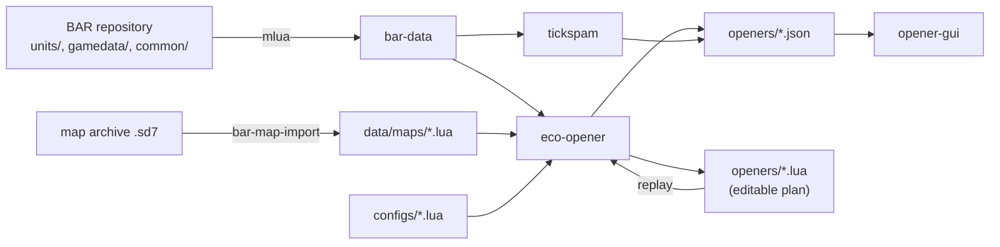

# bar-shenanigans

Tools to simulate and optimize build orders for
[Beyond All Reason](https://github.com/beyond-all-reason/Beyond-All-Reason) (BAR).
The tools read the game data directly from the BAR repository through Lua.



## Crates

| Crate | Purpose |
| --- | --- |
| [`opener-format`](crates/opener-format) | Serde types for `opener.json`, the exchange format between the simulators and the GUI. |
| [`bar-data`](crates/bar-data) | Loads BAR unit defs by running BAR's own `gamedata/unitdefs.lua` in `mlua`. Loads and imports map specs. |
| [`eco-opener`](crates/eco-opener) | Economy simulator and search for the best eco opener. |
| [`tickspam`](crates/tickspam) | Armada Tick spam simulator. See [its README](crates/tickspam/README.md). |
| [`opener-gui`](crates/opener-gui) | Desktop browser for `opener.json` files. See [its README](crates/opener-gui/README.md). |

## Requirements

- [mise](https://mise.jdx.dev). It installs the pinned toolchain (Rust
  1.97.0 with clippy and rustfmt) from [`mise.toml`](mise.toml). Without
  mise: Rust 1.82 or newer.
- A C compiler (`cc`). `mlua` builds its own Lua, so no Lua install is
  necessary.
- The map archive (`.sd7`). `mise run map:fetch` looks in the `maps`
  folder of your BAR installation. Else it downloads the file from the BAR
  map server. Else set `BAR_MAP_FILE` to the file.

## Quick start

```sh
mise install     # toolchain
mise run setup   # BAR repository and map spec
mise run eco:search
mise run gui
```

## Tasks

| Task | What it does |
| --- | --- |
| `bar:pull` | Clones or updates a sparse checkout of the BAR repository in `$BAR_ROOT` (default `../Beyond-All-Reason`). |
| `map:fetch` | Gets `data/maps/all_that_glitters_v2.2.3.sd7` from `$BAR_MAP_FILE`, the local BAR install, or the BAR map server. |
| `map:metadata` | Downloads BAR's maps-metadata `map_list.yaml` (the lobby start positions). |
| `map:import` | Makes `data/maps/all_that_glitters.lua` from the map archive and the map list. |
| `setup` | `bar:pull` and `map:import`. |
| `eco:search [--start P1] [--iterations N] [--runs N]` | Searches for the best eco opener. Writes `openers/all_that_glitters_eco.json` and `.lua` (`_P5` etc. for other start positions). |
| `eco:replay <plan.lua> [--start P1] [--out file]` | Simulates a Lua plan. |
| `tickspam:configs` | Tick spam lab and nano configuration table. |
| `tickspam:search [--start P1]` | Tick spam search. Writes `openers/all_that_glitters_tickspam.json`. |
| `tickspam:replay <plan.lua> [--start P1] [--out file]` | Simulates a tick spam plan. |
| `gui [file]` | Opens an `opener.json` (default: the eco result). |
| `test` | All tests. mise sets `BAR_ROOT`, so the tests against the BAR checkout also run. |
| `lint` | `cargo fmt --check` and `cargo clippy -D warnings`. |

`mise tasks` lists them. Each task is a short `cargo run` command; see
`mise.toml` to run it without mise.

The search also writes the best plan as Lua. Edit it and simulate it
again:

```sh
cp openers/all_that_glitters_eco.lua my_plan.lua
mise run eco:replay my_plan.lua --out openers/my_plan.json
mise run gui openers/my_plan.json
```

## Eco opener search

### Question

Which build order gives the most economy at minute 5, from one start
position, with the Armada commander?

### Plan

A plan is one order queue per builder. The search changes the queues. The
simulator runs them.

```lua
return {
	commander = { "armmex", "armmex", "armwin", "armwin", "armlab" },
	factories = { { "armck", "armck", "armck" } },    -- in the order they are built
	constructors = { { "armmex", "armmex", "armwin" }, -- 1st constructor
	                 { "armwin", "armmex" } },          -- 2nd constructor
}
```

A builder with an empty queue assists. It goes to the nearest factory that
produces. If no factory produces, it goes to the nearest construction.

### Simulation model

```
every 0.1 s:
  idle builders take their next order (mex: nearest free metal spot,
                                       other: nearest free position)
  builders walk until the target is in build range
  income   += commander + extractors * upkeep paid + energy producers
  demand    = sum over working builders of build_power / build_time * cost
  stall     = min(1, metal / demand_metal, energy / demand_energy)
  progress += build_power / build_time * dt * stall
  converters change the energy above 75 % of the storage into metal
  resources above the storage are lost
```

The values come from the BAR unit defs after BAR's post-processing. The
start is 1000 metal, 1000 energy and 1000 storage of each
(`game_team_resources.lua`). Wind is the average of BAR's own table in
`common/wind_functions.lua`.

Not in the model: terrain, pathing, acceleration and turning, wind
variation, reclaim, combat. Each `opener.json` lists its assumptions.

### Objective

`max_eco` (default):

```
score = metal_income + (energy_income - energy_upkeep) / 70
```

at the horizon (300 s). 70 is the energy that a T1 converter changes into
1 metal, so energy counts at the rate at which it can become metal. The
stored resources only break ties.

To use a different objective, set `objective` in the config to Lua source
that returns a function:

```lua
objective = [[
	return function(o)
		-- o: metal_income, energy_income, energy_upkeep, metal, energy,
		--    build_power, metal_wasted, energy_wasted, horizon_s
		return o.metal_income + 0.01 * o.build_power
	end
]],
```

### Search

Simulated annealing over plans. One step inserts, deletes, replaces,
swaps, moves or duplicates an order. Independent runs with fixed seeds
run in parallel, so a result is reproducible. At the end, a prune pass
removes each order that does not improve the score.

### Config

See [`configs/all_that_glitters_eco.lua`](configs/all_that_glitters_eco.lua):
BAR checkout, map spec, start position, commander, allowed units,
horizon, objective, search and simulation settings. Override the start
position with `--start P5`, the effort with `--iterations` and `--runs`,
and the first plan with `--from plan.lua`.

## Map specs

A map spec is a Lua file in `data/maps/`: size, wind, tidal strength,
start positions and metal spots. `bar-map-import` makes it from a map
archive:

- `mapinfo.lua` gives wind, tidal strength, maximum metal and extractor
  radius.
- BAR's [maps-metadata](https://github.com/beyond-all-reason/maps-metadata)
  gives the start positions with the ids and roles of the BAR lobby
  (`--metadata map_list.yaml`). Without it, the start positions come from
  `mapinfo.lua`.
- The `.smf` file gives the size and the metal map.
- BAR's own `common/upgets/api_resource_spot_finder.lua` finds the metal
  spots on that metal map. Thus the spots and their values are the same
  as in the game.

## Tick spam

`crates/tickspam`: Armada Tick spam simulator. Lab and nano configuration
table (the BetterStrategy video question) and a beam search for the
commander build with the most Ticks at minute 3. Writes `opener.json`
(`objective.kind = "max_units"`). See
[crates/tickspam/README.md](crates/tickspam/README.md).

## Opener browser GUI

`crates/opener-gui` shows an `opener.json` step by step: build queue, map
with build positions and builders, metal and energy curves.

```sh
cargo run --release -p opener-gui -- openers/all_that_glitters_eco.json
```

See [crates/opener-gui/README.md](crates/opener-gui/README.md).

## Tests

`mise run test`, or without mise:

```sh
BAR_ROOT=../Beyond-All-Reason cargo test --workspace
```

Without `BAR_ROOT`, the tests against the BAR checkout skip.

## Data sources

| Data | Source |
| --- | --- |
| Unit defs | BAR `units/**/*.lua` with `gamedata/unitdefs_post.lua` and `gamedata/alldefs_post.lua` |
| Unit names | BAR `language/en/units.json` |
| Average wind | BAR `common/wind_functions.lua` |
| Metal spots | BAR `common/upgets/api_resource_spot_finder.lua` on the map's metal map (metal amount = raw byte * `maxMetal`) |
| Converters | BAR `luarules/gadgets/game_energy_conversion.lua` (75 % level) |
| Start resources | BAR `modoptions.lua` defaults and `luarules/gadgets/game_team_resources.lua` |
| Start positions | [BAR maps-metadata](https://github.com/beyond-all-reason/maps-metadata) `map_list.yaml`, else the map's `mapinfo.lua` |
